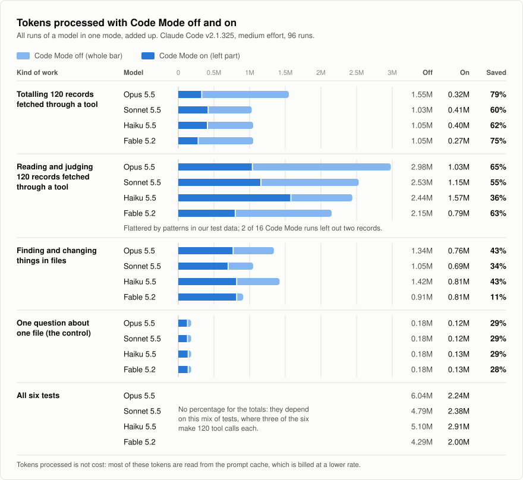

# Archiving: How a New Benchmark Replaces the Current One

[README](README.md) · [Benchmark Guide](BENCHMARK_GUIDE.md) · [Code Mode Overview](CODE_MODE_OVERVIEW.md) · [Predictions](PREDICTIONS.md) · [Results](results/README.md) · [Changelog](CHANGELOG.md)

Code Mode is experimental and changes from one Claude Code release to the next, so this benchmark is run again on later versions. This page is the procedure for doing that without losing or damaging what was already published. It is for whoever maintains the benchmark.

The rule behind every step: **a new run is never published until it has been checked, and the benchmark it replaces is copied and checked before anything is replaced.** At no point is there only one copy.

<p align="center">
  
</p>

<details>
<summary><strong>Contents</strong></summary>

- [Three Places](#three-places)
- [Two Repositories](#two-repositories)
- [Two Version Numbers](#two-version-numbers)
- [What an Archive Holds](#what-an-archive-holds)
- [The Procedure](#the-procedure)
  - [Before the Run](#before-the-run)
  - [1. Make the New Run](#1-make-the-new-run)
  - [2. Validate the New Run](#2-validate-the-new-run)
  - [3. Archive the Current Benchmark](#3-archive-the-current-benchmark)
  - [4. Validate the Archive](#4-validate-the-archive)
  - [5. Promote the New Run](#5-promote-the-new-run)
  - [6. Commit and Tag](#6-commit-and-tag)
- [Publishing](#publishing)
- [Updating the Chart](#updating-the-chart)
- [Showing Older Versions in the README](#showing-older-versions-in-the-readme)
- [Going Back](#going-back)
- [The Raw Transcripts](#the-raw-transcripts)
- [Rehearsing the Archive Step](#rehearsing-the-archive-step)
- [Rules](#rules)
- [What Has Been Tested](#what-has-been-tested)

</details>

## Three Places

| Place                                                              | What it holds                                                                                           | Published?                  |
| ------------------------------------------------------------------ | ------------------------------------------------------------------------------------------------------- | --------------------------- |
| The top of the repository: the documents, `results/` and `assets/` | The **current benchmark**: the results for the newest Claude Code version that has been run and checked | Yes                         |
| `new_run/`                                                         | A **new run** that has not been checked yet                                                             | No. Git ignores this folder |
| `archive/<name>/`                                                  | An **archived benchmark**: a complete copy of an earlier current benchmark, kept unchanged              | Yes                         |

The [archive index](archive/README.md) lists every archived benchmark.

## Two Repositories

The benchmark is kept in two repositories, and they hold different things.

- **The working repository** is private. It holds everything that is published, and also the maintainer's own files: notes, plans, session records and a compressed copy of the raw transcripts. Those files are named in one list, `bin/private-files.txt`.
- **The published repository** holds everything except the files on that list. It is built from the working repository by `bin/publish.py`, as one commit for each publication.

The two share no history. A push sends whole commits, with every file in them, so a branch that has ever held a private file can never be pushed to a public repository. The published copy is exported instead. [Publishing](#publishing) has the commands.

## Two Version Numbers

A result is named by both of these, and they change for different reasons.

- **The Claude Code version** is the thing being tested, such as 2.1.325. Every run records it in its transcript, and `bin/measure.py` prints it.
- **The benchmark version** is this repository's own, such as 0.3.0, in the [changelog](CHANGELOG.md). It changes when the tasks, scripts or reporting change.

A fair comparison between two Claude Code versions uses the same models, the same effort level and tasks that have not changed.

## What an Archive Holds

An archive mirrors the layout of the repository, so that opening its README shows the whole benchmark as it stood, with every link and image working:

```
archive/claude-code-2.1.325/
├── README.md              the front page, with its chart and table
├── BENCHMARK_GUIDE.md
├── CODE_MODE_OVERVIEW.md
├── PREDICTIONS.md
├── CHANGELOG.md
├── ARCHIVING.md
├── LICENSE
├── assets/                the charts and diagrams the documents embed
├── results/               the results page, measure.txt, compare.txt, checks.txt, context reports
└── MANIFEST.json          what was archived, from which commit, with a checksum for every file
```

- **Every top-level document is included,** together with `LICENSE`, everything in `assets/` and everything in `results/`. The files listed in `bin/private-files.txt` are the exception.
- **The files are taken from a commit,** not from the files on disk, so an archive records exactly what was published.
- **One thing is added to each document:** a note at the top saying it is an archived copy, for which Claude Code version and benchmark version, with links to the current benchmark and to the archive index. Raw results, context reports, charts and the licence are byte-for-byte copies.
- **Links between archived files are left alone,** so they lead to the archived copies. A link to something that is not archived, such as the archive index, is pointed at the live file.
- **The scripts, tasks and test data are not copied.** A copy of a script invites someone to run it from the wrong place. The git tag made in step 4 keeps them exactly as they were.
- **Nothing private is included.** `bin/archive.py` skips every file on the list in `bin/private-files.txt`, so the maintainer's notes are never archived.

## The Procedure

Commands are run from the repository's folder. The examples replace Claude Code 2.1.325 with 2.1.326.

### Before the Run

1. **Write down what you expect.** Add a dated section to [PREDICTIONS.md](PREDICTIONS.md) saying what the new version should change, then commit it and [publish](#publishing) it. A prediction published after its test proves nothing.
2. **Check that the current benchmark is committed and valid:** `git status` is clean and `bin/validate.py --claude-code 2.1.325` passes.
3. **Back up the cache folder,** where the transcripts behind the current benchmark live. See [The Raw Transcripts](#the-raw-transcripts).
4. **Rehearse the archive step** on the current benchmark, as described under [Rehearsing the Archive Step](#rehearsing-the-archive-step). It costs a minute and shows the archive will verify before anything depends on it.
5. **Update Claude Code, then hold that version** until the run is finished. `claude --version` should not change part-way.

### 1. Make the New Run

In an ordinary terminal, not from inside a Claude Code session:

```bash
BENCH_RESULTS="$PWD/new_run" REPEAT=2 bin/run-all.py opus sonnet claude-haiku-5-5 fable
```

`BENCH_RESULTS` sends the run's verdicts and context reports to `new_run/`. Nothing in `results/` is touched. Use the same models, the same effort level and the same number of repeats as the benchmark being replaced, or the two cannot be compared.

When it has finished, save its measurements beside them:

```bash
bin/measure.py --claude-code 2.1.326 > new_run/measure.txt
bin/measure.py --claude-code 2.1.326 --compare > new_run/compare.txt
```

`--claude-code` keeps the two versions apart. Without it, `bin/measure.py` reports every run on the machine in one table, and its totals mean nothing.

Do not use `bin/new-round.py` for any of this. It moves `results/measure.txt` and `results/checks.txt` out of the repository.

### 2. Validate the New Run

```bash
bin/validate.py --claude-code 2.1.326 --results new_run --repeat 2
```

It checks what a script can check:

- Every run used one Claude Code version, one effort level and one speed setting.
- Every model has the same number of runs of every test in each mode.
- Every MCP run fetched all 120 tickets from one server process.
- Sessions of one model and mode started within 600 tokens of each other, which is the check that nothing leaked into a session.
- `measure.txt` and `compare.txt` match what `bin/measure.py` prints from the transcripts now.
- `checks.txt` has one verdict for each run, and there is a context report for each scripted run.
- No home-folder path appears in the results folder.

It prints `WARN` for what only a person can judge, and those must be dealt with before going on:

- **Read the transcript of every run that failed its check,** and of its passing twin. A failed check is a result, and the results page has to say what happened and why.
- **Compare with the benchmark being replaced.** A figure that moved a long way needs a reason found in a transcript, not a guess.
- **Check the exact model names.** An alias such as `sonnet` can point at a newer model than last time.

Stop here if the run is not good. Delete `new_run/`, fix the cause and run again. Nothing published has changed.

### 3. Archive the Current Benchmark

Commit anything outstanding first, then:

```bash
bin/archive.py create --claude-code 2.1.325
```

This copies the current benchmark, as it is in the last commit, into `archive/claude-code-2.1.325/`, adds the note to each document, writes `MANIFEST.json` and rewrites the [archive index](archive/README.md). It refuses to run if a document or result has uncommitted changes, and it never overwrites an archive that exists.

If the same Claude Code version is benchmarked a second time, give the archive its own name with `--label`, such as `--label claude-code-2.1.325_benchmark-0.3.0`.

### 4. Validate the Archive

```bash
bin/archive.py verify claude-code-2.1.325
```

It checks that:

- every file in the manifest is present, and nothing else is;
- every file matches its checksum;
- every file is what the source commit published, with only the note added to documents;
- every local link and image inside the archive resolves;
- `results/measure.txt` can be regenerated from the raw transcripts, byte for byte, where those transcripts are on the machine.

Then look at it. Open `archive/claude-code-2.1.325/README.md` in a Markdown preview or on GitHub and click through to the results page, the guide and the chart. It should read as the benchmark did when it was live.

Tag the commit the archive was made from, using the command `bin/archive.py create` printed, and commit the archive by itself:

```bash
git tag benchmark-0.3.0_claude-code-2.1.325 <commit>
git add archive && git commit -m "Archive the benchmark for Claude Code 2.1.325"
```

The archive is committed before anything at the top level is edited. From here on, the old benchmark exists twice: in its folder and under its tag.

### 5. Promote the New Run

```bash
bin/archive.py promote --from new_run --claude-code 2.1.326
```

It refuses unless the current benchmark has an archive that verifies and the new run validates. It then copies `checks.txt`, `measure.txt`, `compare.txt` and the context reports from `new_run/` into `results/`.

The rest is writing, and it is the larger part of the work:

1. **`results/README.md`:** every table regenerated from `bin/measure.py --claude-code 2.1.326 --json`, never typed; what Claude did; any failed checks; a new entry in the run log.
2. **`README.md`:** the summary table and its chart for the new version, the findings, and a folded block for the version just archived ([below](#showing-older-versions-in-the-readme)).
3. **The chart:** `assets/tokens-processed-summary.svg` redrawn for the new figures and checked against the data. [Updating the Chart](#updating-the-chart) has the prompt and the checks.
4. **`BENCHMARK_GUIDE.md`:** costs, timings and anything the new version changed.
5. **`CHANGELOG.md`:** an entry for the new results. The benchmark version changes only if the tasks, scripts or reporting changed.

Then check it as the last benchmark was checked: `bin/validate.py --claude-code 2.1.326`, and `bin/publish.py check --worktree`, which checks every local link, image and anchor in the documents and searches them for anything private.

### 6. Commit and Tag

Commit the promotion as one commit, apart from the archive commit, and tag it:

```bash
git add -A && git commit -m "Benchmark for Claude Code 2.1.326"
git tag benchmark-0.3.0_claude-code-2.1.326
git push && git push --tags
```

Two commits, two tags. Either step can be undone without the other.

The compressed transcripts for the new version go into the same commit; see [The Raw Transcripts](#the-raw-transcripts). The push goes to the private remote of the working repository, and it publishes nothing.

## Publishing

The published repository gets its contents from `bin/publish.py`, which works from the last commit of the working repository:

```bash
bin/publish.py check
bin/publish.py commit --to ../public-clone --message "Benchmark for Claude Code 2.1.326" --tag benchmark-0.3.0_claude-code-2.1.326
```

`check` builds the published copy in a temporary folder and tests it. It fails if:

- a file on the private list is in the copy;
- a local link, image or anchor in a document leads nowhere inside the copy, which is how a link from a published document to a private file is caught;
- a file holds a secret, a home-folder path, an email address, or a term the maintainer has listed as private;
- a script does not parse.

`commit` runs the same checks. It then replaces the contents of a clone of the published repository with the copy and makes one commit there, with a tag if one is given. `--to` names that clone; for the first publication it is an empty folder after `git init`. It refuses the working repository, a clone of it, anything that shares a commit with it, and a clone with uncommitted changes. It never pushes. Look at the commit, then push it from that clone. The commit and its tag carry the name and email set in the working repository with `git config --local user.name` and `git config --local user.email`, whatever any other git setting or environment variable says, and they become public with it. `commit` refuses to run until both are set, checks the commit's author and committer afterwards, and refuses a message or tag that would publish something private. For the first publication, add the public repository as that clone's remote and push with `git push -u origin HEAD`.

`bin/publish.py export --to <folder>` writes the same checked copy to an empty folder, to read before anything is committed. `bin/publish.py check --worktree` checks the files on disk instead of the last commit, for use before a commit.

**The working repository is never pushed to a public remote.** A pre-push hook refuses every push to a remote other than the private one, whatever the push carries. It is installed once in each clone of the working repository. It is copied, not linked, so that it is still there when an older commit is checked out:

```bash
cp .githooks/pre-push "$(git rev-parse --git-path hooks)/pre-push"
git config benchmark.privateRemote "$(git remote get-url origin)"
```

- **The hook compares addresses and nothing more.** It cannot tell whether the private repository is still private. If that repository were ever made public, everything in it would be exposed.
- **A publication carries its own tag.** Tags made in the working repository stay there. `--tag` puts the same name on the published commit, so that `git checkout <tag>` works for a reader.
- **An archive names a commit of the working repository** in its `MANIFEST.json`. That commit is not in the published repository, so there `bin/archive.py verify` checks the files against the manifest only, and says so.

## Updating the Chart

`assets/tokens-processed-summary.svg` was drawn in a Claude Desktop chat from the README's summary table. It has no generator in this repository, so it is redrawn by hand when the figures change. Attach the current chart and README to a chat and adapt the prompt below, replacing its table and its list of changes.

<details>
<summary><strong>The prompt used to update the chart for 96 runs</strong></summary>

```text
I'm attaching two files: tokens-processed-summary.svg, a chart that my project's README embeds, and the current README.md. Please update the SVG in place and give me back the finished file. Nothing else in this message depends on an earlier conversation.

Background. The project is a public benchmark of what Claude Code's "Code Mode" changes. It has six tests, each run with Code Mode off and on, across four models. The chart shows one measure, "tokens processed", by kind of work and model. Each row is one bar: the whole bar is Code Mode off, the left part is Code Mode on, and the remainder is what was saved. The Off, On and Saved figures sit beside each bar. The README embeds the image at 880 pixels wide on GitHub (), and the chart also gets shared on its own, without the README. Treat the existing design as settled: layout idea, colours, type, card background, light and dark behaviour, legend, title. Do not redesign anything.

Make exactly these changes and no others.

1. New figures. Opus 5.5 changed in two groups, because two more runs were added. Every other figure stays as it is. The table below is the source of truth. It should match the table in the attached README under "The same figures as a table". If the two ever disagree, or if a figure in the current SVG outside the two Opus groups differs from my table, stop and tell me instead of choosing one.

| Kind of work | Model | Off | On | Saved |
| --- | --- | --- | --- | --- |
| Totalling 120 records fetched through a tool | Opus 5.5 | 1.55M | 0.32M | 79% |
| | Sonnet 5.5 | 1.03M | 0.41M | 60% |
| | Haiku 5.5 | 1.05M | 0.40M | 62% |
| | Fable 5.2 | 1.05M | 0.27M | 75% |
| Reading and judging 120 records fetched through a tool | Opus 5.5 | 2.98M | 1.03M | 65% |
| | Sonnet 5.5 | 2.53M | 1.15M | 55% |
| | Haiku 5.5 | 2.44M | 1.57M | 36% |
| | Fable 5.2 | 2.15M | 0.79M | 63% |
| Finding and changing things in files | Opus 5.5 | 1.34M | 0.76M | 43% |
| | Sonnet 5.5 | 1.05M | 0.69M | 34% |
| | Haiku 5.5 | 1.42M | 0.81M | 43% |
| | Fable 5.2 | 0.91M | 0.81M | 11% |
| One question about one file (the control) | Opus 5.5 | 0.18M | 0.12M | 29% |
| | Sonnet 5.5 | 0.18M | 0.12M | 29% |
| | Haiku 5.5 | 0.18M | 0.13M | 29% |
| | Fable 5.2 | 0.18M | 0.13M | 28% |
| All six tests (no percentage) | Opus 5.5 | 6.04M | 2.24M | |
| | Sonnet 5.5 | 4.79M | 2.38M | |
| | Haiku 5.5 | 5.10M | 2.91M | |
| | Fable 5.2 | 4.29M | 2.00M | |

The "All six tests" group keeps its Off and On figures only, with no bars and no percentage, as it does now.

2. Extend the axis to 3M. The longest bar is now 2.98M, past the old last tick at 2.5M. Keep the same tick spacing (0, 0.5M, 1M, 1.5M, 2M, 2.5M, 3M) and redraw every bar to the new scale, so all bars stay comparable with each other. Calculate each bar's length from its figure on the new axis, with the On part and the Off total both coming from the table. Do not adjust by eye.

3. Remove the "Runs per mode" column, header and values. Every model now has the same number of runs, so the column says nothing. Keep the canvas width and viewBox unchanged, so the text keeps its size when embedded at 880 pixels. Give the freed space to the bar area, and keep the remaining columns evenly spaced and aligned.

4. In the subtitle, change "94 runs" to "96 runs". The rest of the subtitle stays.

5. Add one caution line to the group "Reading and judging 120 records fetched through a tool": "Flattered by patterns in our test data; 2 of 16 Code Mode runs left out two records." It must be inside the image, because the chart is shared without the README and a reader of that group's big savings should see the caveat there. Use the same muted text style as the note already in the "All six tests" group. Place it so it clearly belongs to that group (for example directly under that group's last row or beside its heading, whichever is clearer), and not so that it could be read as belonging to the group above or below. If it does not fit on one line at the chart's width, split it over two lines at the semicolon, and make room for it without squeezing the rows.

6. Keep the two notes already there: the note in the "All six tests" group saying why no percentage is given (the totals depend on this mix of tests), and the bottom line "Tokens processed is not cost". Do not add any other note, caption, label or decoration. I want small details that don't change how a number is read left out.

7. Update the <title> and <desc> so they state every figure in words for screen readers, matching the new figures. Remove any mention of runs per mode, and state the new axis if the current text mentions it. Include the new caution in the <desc>.

8. Add this comment on its own line directly after the opening <svg ...> tag, exactly as written: <!-- Copyright © 2026 Bicameral, LLC. All rights reserved. See LICENSE. -->

Use British spelling in any text you write in the chart. Do not edit README.md. It is attached only so you can check the figures and see how the image is embedded. Create no other files.

Before you hand it back, check your own work.
- Compare every figure in the drawn image, and in <title> and <desc>, with the table above. Bars should reproduce the table when read against the axis.
- Render the SVG at 880 pixels wide once in light mode and once in dark mode (emulate the colour scheme if your tools allow it), and look at both. Check for overlapping or clipped text and for misaligned columns, especially around the new caution line and the space freed by the removed column. Fix anything you find and render again.
- If you cannot render it, say so plainly instead of reporting that you checked.

Return: the single file tokens-processed-summary.svg, and a short note (a few bullets) that lists what changed and anything you were unsure about or had to decide. No restatement of this brief.
```

</details>

Check the new chart against the data, not by eye, before it is committed:

- **Every figure** in the image and in its screen-reader text matches `bin/measure.py`.
- **Every bar's length** is computed from its figure and the axis scale and compared with what is drawn. A chart can print the right number beside a bar drawn for the wrong one.
- **It is rendered in light and in dark** and looked at for clipped or overlapping text. Some renderers ignore the rule that switches an SVG to its dark colours and return the light version twice; apply the dark colours to a copy to see them.

## Showing Older Versions in the README

The README always shows the newest version that has been run. Each archived version gets a folded block beneath the current summary, newest first, so two versions can be compared at a glance:

```markdown
<details>
<summary><strong>Claude Code 2.1.325 (benchmark 0.3.0), archived 2026-12-01</strong></summary>

<p align="center">
  
</p>

[The full benchmark as published for Claude Code 2.1.325](archive/claude-code-2.1.325/README.md)

</details>
```

The image and the link point into the archive, so the block cannot drift from what was published. Where a comparison across versions is written, it uses the models both versions ran.

## Going Back

- **To undo a promotion:** `git revert <the promotion commit>`. The top level returns to the previous benchmark. The archive stays, which does no harm.
- **To see exactly what was published for a version,** scripts included: `git checkout benchmark-0.3.0_claude-code-2.1.325`.
- **After going back, publish again.** The published repository changes only through `bin/publish.py commit`.
- **To make an archived benchmark current again by hand:** `git checkout <its tag> -- README.md BENCHMARK_GUIDE.md CODE_MODE_OVERVIEW.md PREDICTIONS.md CHANGELOG.md ARCHIVING.md results assets`, then commit. Take the files from the tag, not from the archive folder, because the archived documents carry the note.

## The Raw Transcripts

Every number comes from the transcripts Claude Code saves, and those are **not** published. They sit in the benchmark's cache folder on the machine that made the runs, and they contain paths from that machine. The maintainer keeps a compressed copy of them in the working repository, one file for each Claude Code version, made when that version's benchmark is promoted and not rewritten afterwards. Each file holds everything up to and including its version, so only the newest is ever restored. It is on the private list.

- **Without them an archived benchmark cannot be recomputed.** `bin/archive.py verify` says so when it cannot find them, and checks the files against the manifest and the commit only.
- **`bin/clean.py` deletes them.** Do not run it while a published benchmark depends on that machine's transcripts.
- **Back the cache folder up** somewhere private before a round on a new version, and again as soon as the round finishes. Until the compressed copy for a version is made and committed, the cache folder and that backup are the only copies of its evidence.

## Rehearsing the Archive Step

The archive step can be tried at any time without creating an archive. `--out` sends it to a throwaway folder beside `archive/`, which git ignores:

```bash
bin/archive.py create --claude-code 2.1.325 --out "$PWD/archive-trial"
bin/archive.py verify --out "$PWD/archive-trial"
rm -r archive-trial
```

Open `archive-trial/claude-code-2.1.325/README.md` before removing it, to see the benchmark as an archived reader would. An archive is made from the last commit, so repeat the rehearsal after any commit that changes a published document or result.

## Rules

- **An archive is never edited.** If something in it is wrong, say so in the current documents. `bin/archive.py verify` fails on any change.
- **One new run at a time.** `new_run/` is emptied before a new round starts.
- **A new run is compared with the benchmark it replaces before it is promoted,** not afterwards.
- **Runs from two Claude Code versions are never added together** in a table.
- **A promotion that changes tasks or scripts is two changes.** Change the benchmark first, as its own version, and rerun; then compare Claude Code versions on an unchanged benchmark.

## What Has Been Tested

On 2026-11-16 the archive step was tried on the current benchmark, for Claude Code 2.1.325, into a throwaway folder that was then removed:

- `bin/validate.py --claude-code 2.1.325` passed, with the two known failed checks listed for reading.
- `bin/archive.py create` copied 106 files, and `verify` passed, including regenerating `measure.txt` from the transcripts byte for byte.
- The archived README differed from the published one by the note alone, and the raw results and chart were identical.
- Changing one figure in the archived results page made `verify` fail, which shows the check can fail.

On the same day the private list, the published copy and the push guard were tried in a throwaway clone that held private files:

- `bin/archive.py create` still copied 106 files, none of them private, and `verify` passed.
- `bin/publish.py check` passed on 134 files and 228 links, images and anchors. It failed, as it should, on each of these in turn: a link to a private file, a link to a heading that does not exist, a home-folder path, a token, a listed term, an email address, and a script that does not parse.
- `bin/publish.py commit` made one commit of 134 files in an empty repository, made none when run again with nothing changed, and made a second after a change. It refused the working repository, a clone of it, a folder inside a repository, and a clone with uncommitted changes.
- The pre-push hook refused a branch, a tag and a bare commit pushed to a remote other than the private one, and any push made while a commit older than the hook was checked out. It allowed the same pushes to the remote recorded as private.

On 2026-11-17 the first real pass began, with Claude Code 2.1.326:

- The new run went to `new_run/` with `BENCH_RESULTS` set: 96 runs on four models, twice each, in about an hour and a half. The published `results/` folder did not change.
- `bin/validate.py --claude-code 2.1.326 --results new_run --repeat 2` passed, with three failed checks listed for reading. The runs on 2.1.325 recorded on the same machine were left out, as they should be.
- `bin/archive.py create --claude-code 2.1.325` made the archive in `archive/` for real: 106 files, none of them on the private list. `verify` passed, a changed figure made it fail, and undoing the change made it pass again. The source commit was tagged and the archive committed by itself.

- `bin/archive.py promote --from new_run --claude-code 2.1.326` validated the new run, verified the archive again, and replaced `checks.txt`, `measure.txt`, `compare.txt` and the context reports in `results/`. The 2.1.325 context reports left `results/` with it; they are kept in the archive.
- The README gained its folded block for 2.1.325, with the archived chart and a link into the archive, and the chart was redrawn with the prompt under [Updating the Chart](#updating-the-chart) and checked against the data by figure and by bar length.

Not yet tested: a first publication to the public repository. This page will be corrected from what it shows.

---

© 2026 Bicameral, LLC. All rights reserved. See [LICENSE](LICENSE).
