> [!NOTE]
> **Archived benchmark.** This is the benchmark as it was published for Claude Code 2.1.325 (benchmark version 0.3.0), archived on 2026-11-17 and kept unchanged. See the [current benchmark](../../README.md) or [all archived benchmarks](../README.md).

# Code Mode: An Overview

What code mode is, why agent tools are adopting it, which harnesses have it, and which gateways and services add it.

> [!NOTE]
> Compiled in November 2026 from each project's own documentation, changelogs and repositories. We have not tested the products listed here, they are not ranked, and this field changes monthly. Check the linked pages before relying on a detail. Corrections are welcome as issues.

[README](README.md) · [Benchmark Guide](BENCHMARK_GUIDE.md) · [Code Mode Overview](CODE_MODE_OVERVIEW.md) · [Predictions](PREDICTIONS.md) · [Results](results/README.md) · [Changelog](CHANGELOG.md)

<strong>Contents</strong>

- [What It Is](#what-it-is)
- [Why It Is Needed](#why-it-is-needed)
- [Code Mode Across the AI Industry](#code-mode-across-the-ai-industry)
  - [Where It Stands](#where-it-stands)
  - [Related Ideas](#related-ideas)
- [Code Mode in Agent Harnesses](#code-mode-in-agent-harnesses)
  - [Clients Without a Built-In Code Mode](#clients-without-a-built-in-code-mode)
- [Gateways and Services That Add Code Mode](#gateways-and-services-that-add-code-mode)
  - [1. For Individual Developers and Local Clients](#1-for-individual-developers-and-local-clients)
  - [2. Managed Platforms and Cloud Gateways](#2-managed-platforms-and-cloud-gateways)
  - [3. Self-Hosted Infrastructure and Enterprise Scale](#3-self-hosted-infrastructure-and-enterprise-scale)
- [Side-by-Side Comparison](#side-by-side-comparison)
- [Where to Start](#where-to-start)
- [Sources](#sources)

## What It Is

An agent normally uses tools in steps: it asks for one or a few calls, waits for the results, reads them in full, and decides what to do next. In code mode the model writes a short program that makes the calls itself. The program runs in a sandbox or in the agent's own session, and only what it returns goes back to the model.

  

The same idea goes by several names: code mode, code execution with MCP, programmatic tool calling, and CodeAct in the research literature. On this page, lower-case "code mode" means the general idea, and "Code Mode" means a product's own feature of that name.

The name is also used for something else. In many coding tools, "code mode" or a similar label means the mode in which the agent may edit files and run commands, as opposed to a read-only planning or asking mode. That is about permissions. This page is about the other meaning: the model writing a program that calls its tools.

## Why It Is Needed

An agent that calls tools one at a time pays for it in three ways.

| Cost                     | What happens                                                                                                                                                                                              |
| ------------------------ | --------------------------------------------------------------------------------------------------------------------------------------------------------------------------------------------------------- |
| **Tool definitions**     | Every connected tool's name, description and schema is sent to the model on every request, used or not. With many MCP servers connected, this can fill a large part of the context before any work starts |
| **Intermediate results** | A file read only to be filtered, or a list fetched only to be counted, is added to the conversation in full                                                                                               |
| **Round trips**          | The model is called again after each tool result, which costs time as well as tokens                                                                                                                      |

Two techniques answer these, and products often ship both:

- **Finding tools on demand** (also called tool search, lazy or deferred loading, or progressive discovery) addresses the first cost. The model sees a few tools for searching the catalogue and loads a definition only when it needs it.
- **Code mode** addresses the second and third. Loops, filters and parallel calls happen in the sandbox, and the model reads only the answer.

Code mode is not free. It adds a sandbox to secure, it moves permission checks from single calls to whole programs, and it helps little on tasks that need one or two calls.

The savings quoted for it are large. Anthropic's post describes one workflow going from 150,000 tokens to 2,000. Figures like that are vendors' own examples, chosen to show the effect. Measuring it on ordinary work is the point of [this repository](README.md).

## Code Mode Across the AI Industry

The idea is older than its name. In 2024 the [CodeAct paper](https://arxiv.org/abs/2402.01030) argued that agents which act by writing executable code do better than agents which emit one structured tool call at a time, and libraries such as Hugging Face's [smolagents](https://github.com/huggingface/smolagents) built on it.

What made it urgent was the [Model Context Protocol](https://www.anthropic.com/news/model-context-protocol). Once tools were easy to connect, agents went from a handful to hundreds, and the cost of sending every definition and every result through the model became hard to ignore.

Coding agents found an early answer in the terminal. Through 2025 many developers started handing agents a command-line tool such as `gh` in place of an MCP server, because the model already knows the commands, nothing is loaded up front, and output can be piped and filtered before the model reads it. Armin Ronacher made the case in [Tools: Code Is All You Need](https://lucumr.pocoo.org/2025/7/3/tools/), and others [benchmarked CLIs against MCP servers](https://mariozechner.at/posts/2025-08-15-mcp-vs-cli/). Code mode is the next step on the same path: the same composition in code, but over any tool, with typed functions, a sandbox and permission checks.

Cloudflare gave the answer a name in September 2025, Anthropic wrote up the same approach that November, and through 2026 the coding harnesses and then the MCP gateways built it in.

| When     | What happened                                                                                                                                                                                                                                                                                                               |
| -------- | --------------------------------------------------------------------------------------------------------------------------------------------------------------------------------------------------------------------------------------------------------------------------------------------------------------------------- |
| Mid 2025 | Developers start giving coding agents command-line tools and a shell in place of MCP servers. [Tools: Code Is All You Need](https://lucumr.pocoo.org/2025/7/3/tools/) argues that code is the better interface                                                                                                              |
| Sep 2025 | Cloudflare publishes [Code Mode: the better way to use MCP](https://blog.cloudflare.com/code-mode/): turn MCP tools into a TypeScript API and let the model write code against it, on the argument that models are better at writing code than at emitting tool calls                                                       |
| Nov 2025 | Anthropic publishes [Code execution with MCP](https://www.anthropic.com/engineering/code-execution-with-mcp), then ships [programmatic tool calling](https://platform.claude.com/docs/en/agents-and-tools/tool-use/programmatic-tool-calling) on the Claude API. MCPProxy and Docker's MCP Gateway add code execution tools |
| Dec 2025 | [goose](https://goose-docs.ai/docs/guides/managing-tools/code-mode/) adds a Code Mode extension                                                                                                                                                                                                                             |
| Mar 2026 | Code Mode appears in the OpenAI Codex CLI changelog as an experimental feature. Cloudflare opens the sandbox it runs on, Dynamic Workers, as a beta                                                                                                                                                                         |
| Mid 2026 | Gateways follow: agentgateway documents Code and CodeSearch tool modes, and Bifrost, Composio and Executor offer their own versions. Vercel adds an experimental code mode to its AI SDK                                                                                                                                    |
| Oct 2026 | [OpenCode 2.0](https://opencode.ai/docs/tools/) turns Code Mode on by default for MCP servers. Speakeasy adds a [gateway Code Mode](https://github.com/speakeasy-api/gram/pull/6978) to Gram                                                                                                                                |
| Nov 2026 | Claude Code adds [Code Mode](https://code.claude.com/docs/en/code-mode) in v2.1.323                                                                                                                                                                                                                                         |

### Where It Stands

- **Widely built in, unevenly finished.** It is stable on the Claude API and part of OpenCode's normal tool set, but still experimental in Claude Code, Cloudflare's Agents SDK and Docker's gateway.
- **No common design.** Coding harnesses mostly have the model write JavaScript. Hosted platforms often use Python or a Python-like language. Each product has its own sandbox and its own rules for what a script may do.
- **Not everywhere.** We found no built-in code mode documented for Gemini CLI, Cursor or GitHub Copilot CLI. See [clients without a built-in code mode](#clients-without-a-built-in-code-mode).
- **Open questions.** Checking a whole program is different from approving one tool call, and products disagree on how to do it. We found no independent benchmark of code mode in coding agents: the savings figures in circulation are vendors' own examples.

### Related Ideas

| Idea                                                                                       | How it relates                                                                                                                                                                                                 |
| ------------------------------------------------------------------------------------------ | -------------------------------------------------------------------------------------------------------------------------------------------------------------------------------------------------------------- |
| **Finding tools on demand** (tool search, deferred or lazy loading, progressive discovery) | Solves the other half of the problem: the model loads a tool's definition only when it needs it. Most products now ship this alongside code mode                                                               |
| **[Agent Skills](https://www.anthropic.com/news/skills)**                                  | The same principle applied to instructions: load them when the task calls for them, not on every request                                                                                                       |
| **MCP gateways and proxies**                                                               | One endpoint in front of many MCP servers. Many now offer tool search, a code mode, or both                                                                                                                    |
| **Agent sandboxes**                                                                        | Code mode needs somewhere safe to run model-written code, which has driven work on small, fast, tightly limited sandboxes such as Cloudflare's [Dynamic Workers](https://blog.cloudflare.com/dynamic-workers/) |

## Code Mode in Agent Harnesses

| Harness                     | How it does it                                                                                                                        | Status                                                      | Link                                                                                            |
| --------------------------- | ------------------------------------------------------------------------------------------------------------------------------------- | ----------------------------------------------------------- | ----------------------------------------------------------------------------------------------- |
| **Claude Code** (Anthropic) | Claude writes JavaScript that calls its tools, run inside the session                                                                 | Experimental, off by default                                | [Docs](https://code.claude.com/docs/en/code-mode)                                               |
| **Codex CLI** (OpenAI)      | The model writes JavaScript that calls tools, including MCP tools                                                                     | In the changelog since v0.114.0                             | [Changelog](https://developers.openai.com/codex/changelog)                                      |
| **OpenCode**                | An `execute` tool runs JavaScript that calls and combines tools from its catalogue                                                    | Available unless you deny it; on for MCP servers by default | [Docs](https://opencode.ai/docs/tools/)                                                         |
| **goose**                   | A Code Mode extension: the model writes JavaScript, run in a sandbox with no file, shell or network access of its own                 | Extension you switch on                                     | [Docs](https://goose-docs.ai/docs/guides/managing-tools/code-mode/)                             |
| **Cloudflare Agents SDK**   | For agents built on Cloudflare: tools become an API and model-written code runs in an isolated sandbox                                | Experimental                                                | [Docs](https://developers.cloudflare.com/agents/tools/codemode/)                                |
| **Vercel AI SDK**           | For apps built on the SDK: the model writes JavaScript or TypeScript that calls your AI SDK tools, run in an isolated QuickJS sandbox | Experimental                                                | [Docs](https://ai-sdk.dev/docs/ai-sdk-core/code-mode)                                           |
| **Claude API** (Anthropic)  | Programmatic tool calling: Claude calls your tools from code in a hosted code execution container                                     | Stable                                                      | [Docs](https://platform.claude.com/docs/en/agents-and-tools/tool-use/programmatic-tool-calling) |

The last three rows are frameworks and an API for building your own agent, not finished coding tools.

### Clients Without a Built-In Code Mode

Gemini CLI, Cursor and GitHub Copilot CLI had no built-in code mode that we could find in their documentation in November 2026. They call MCP tools the ordinary way, one structured call at a time.

All three do have the other kind of "code mode": a mode for editing, set against a read-only planning mode. The table lists those so the two are not confused.

| Client                  | Built-in code mode | Editing and planning modes                                                                                     | Docs                                                                                     |
| ----------------------- | ------------------ | -------------------------------------------------------------------------------------------------------------- | ---------------------------------------------------------------------------------------- |
| **Gemini CLI** (Google) | None found         | Approval modes `default`, `auto_edit`, `yolo` and `plan`. Shift+Tab cycles through default, auto-edit and plan | [Plan mode](https://github.com/google-gemini/gemini-cli/blob/main/docs/cli/plan-mode.md) |
| **Cursor**              | None found         | Agent, Ask, Plan and Debug. Shift+Tab or the mode picker switches between them                                 | [Agent mode](https://cursor.com/help/ai-features/agent)                                  |
| **GitHub Copilot CLI**  | None found         | Interactive, plan and autopilot. Shift+Tab cycles through them                                                 | [Docs](https://docs.github.com/en/copilot/how-tos/copilot-cli/use-copilot-cli/overview)  |

Several guides report that Google moved individual subscribers from Gemini CLI to its Antigravity CLI in June 2026. We found no code mode documented for Antigravity CLI either.

There are three ways to get the effect in these clients:

1. **Connect a gateway that has a code mode.** Any client that speaks MCP can use one. See [the gateways below](#gateways-and-services-that-add-code-mode).
2. **Use Cloudflare's MCP server portals,** which can put Code Mode in front of your own MCP servers ([changelog](https://developers.cloudflare.com/changelog/post/2026-03-26-mcp-portal-code-mode/)). This is a different product from Cloudflare's own API MCP server, which offers Cloudflare's API through two tools, search and execute.
3. **Let the agent write a script and run it in the shell.** All three can do this, and it gives the same composition and filtering. It is not the same thing, though: there is no dedicated sandbox and no typed API for your tools, and the script runs with whatever the agent's shell is allowed to do.

## Gateways and Services That Add Code Mode

A gateway sits between an agent and its MCP servers. It bundles many servers behind one endpoint, and the ones listed here can also offer the agent a code mode of their own. That is useful when your agent has none, or when you want the same behaviour across several agents.

Not every MCP gateway has a code mode. Many reduce context only by finding tools on demand. The "Code mode" column says which is which.

### 1. For Individual Developers and Local Clients

For one person bundling local MCP servers behind a single endpoint for Claude Code, Codex, Cursor, Windsurf or Claude Desktop.

| Tool                                                                                      | What it is                                                                                                                                                                                                        | Code mode                                                                                                                                                     |
| ----------------------------------------------------------------------------------------- | ----------------------------------------------------------------------------------------------------------------------------------------------------------------------------------------------------------------- | ------------------------------------------------------------------------------------------------------------------------------------------------------------- |
| [**MCPProxy**](https://mcpproxy.app/)                                                     | An open-source proxy that runs on your machine and puts all your MCP servers behind one local endpoint, with tool search and a web UI ([source](https://github.com/smart-mcp-proxy/mcpproxy-go))                  | **Yes.** A `code_execution` tool runs JavaScript or TypeScript in a restricted sandbox that can call the upstream tools. On by default since v0.66.0          |
| [**Executor**](https://executor.sh)                                                       | An open-source gateway that connects your accounts and tools in one place for any agent. Runs as a desktop app, a CLI, self-hosted, or as Executor Cloud ([source](https://github.com/UsefulSoftwareCo/executor)) | **Yes.** Tools are plain JavaScript functions the agent writes code against. Saved code can run on a schedule or a webhook                                    |
| [**Docker MCP Gateway**](https://docs.docker.com/ai/mcp-catalog-and-toolkit/dynamic-mcp/) | Part of Docker's MCP Toolkit. Runs each MCP server in its own container, isolated from the host, and lets an agent find and add servers during a session                                                          | **Experimental.** A `code-mode` tool creates JavaScript functions that combine tools from several servers. Docker says it is not yet reliable for general use |

### 2. Managed Platforms and Cloud Gateways

For agents running in production, where a hosted service runs the sandbox and handles sign-in to third-party apps.

| Tool                                                                                 | What it is                                                                                                                                                                                                                                                                                                                                                                                          | Code mode                                                                                                                                                                                                     |
| ------------------------------------------------------------------------------------ | --------------------------------------------------------------------------------------------------------------------------------------------------------------------------------------------------------------------------------------------------------------------------------------------------------------------------------------------------------------------------------------------------- | ------------------------------------------------------------------------------------------------------------------------------------------------------------------------------------------------------------- |
| [**Cloudflare Code Mode**](https://developers.cloudflare.com/agents/tools/codemode/) | Where the name comes from. A feature of Cloudflare's Agents SDK, plus a pattern for MCP servers that expose a whole API through two tools, search and execute ([blog](https://blog.cloudflare.com/code-mode-mcp/)). Its MCP server portals can also put Code Mode in front of your own MCP servers ([changelog](https://developers.cloudflare.com/changelog/post/2026-03-26-mcp-portal-code-mode/)) | **Yes, experimental.** Model-written code runs in isolated, short-lived Workers                                                                                                                               |
| [**Composio**](https://docs.composio.dev/docs/sandbox/remote)                        | A managed platform with a large catalogue of app integrations and per-user sign-in handled for you, reached through one hosted MCP endpoint                                                                                                                                                                                                                                                         | **Yes, as its sandbox.** A persistent Python environment where the agent writes and runs code that can reach Composio tools. On by default in a standard session                                              |
| [**Speakeasy Gram**](https://github.com/speakeasy-api/gram)                          | A platform for building and hosting MCP servers from your APIs, with a gateway, logging and a dashboard                                                                                                                                                                                                                                                                                             | **Rolling out.** A gateway Code Mode, where the model writes Python against one `execute` tool, was [added in late 2026](https://github.com/speakeasy-api/gram/pull/6978) and is switched on per organisation |

### 3. Self-Hosted Infrastructure and Enterprise Scale

For teams that run the gateway on their own infrastructure, often Kubernetes, and need limits, policy and audit across many agents.

| Tool                                                                                                 | What it is                                                                                                                                         | Code mode                                                                                                                                                                                                           |
| ---------------------------------------------------------------------------------------------------- | -------------------------------------------------------------------------------------------------------------------------------------------------- | ------------------------------------------------------------------------------------------------------------------------------------------------------------------------------------------------------------------- |
| [**Bifrost**](https://docs.getbifrost.ai/mcp/code-mode)                                              | An open-source AI gateway from Maxim that combines model routing with centrally managed MCP servers ([source](https://github.com/maximhq/bifrost)) | **Yes.** Switched on per MCP client. The model sees four tools for listing, reading and running, and writes Python that runs in a Starlark sandbox with no imports, files or network                                |
| [**agentgateway**](https://docs.solo.io/agentgateway/kubernetes/latest/documentation/mcp/tool-mode/) | An open-source gateway for MCP and agent-to-agent traffic, with an enterprise build from Solo.io                                                   | **Yes, in the enterprise build.** Four tool modes: Standard, Search, Code and CodeSearch. In Code mode the agent sees one `run_code` tool and writes JavaScript. Solo's docs label tool modes an Enterprise feature |
| [**TrueFoundry**](https://www.truefoundry.com/docs/agent-platform/agent-harness/overview)            | An enterprise AI platform with an MCP gateway and an agent harness, run on Kubernetes                                                              | **Yes, in its agent harness.** One sandbox script chains MCP tool calls. Its gateway also loads tool definitions on demand                                                                                          |
| [**Microsoft mcp-gateway**](https://github.com/microsoft/mcp-gateway)                                | An open-source (MIT) reverse proxy and management layer for MCP servers on Kubernetes                                                              | **No.** It routes requests and manages servers; its README describes no code mode                                                                                                                                   |

## Side-by-Side Comparison

| Gateway or service        | Target audience                           | Primary strengths                                                                               | Code mode                                   | Deployment                         |
| ------------------------- | ----------------------------------------- | ----------------------------------------------------------------------------------------------- | ------------------------------------------- | ---------------------------------- |
| **MCPProxy**              | Local developers and their clients        | One local endpoint for every server, tool search, a web UI that shows each script and its calls | Yes, on by default (JavaScript, TypeScript) | Local app                          |
| **Executor**              | Local developers, small teams             | Accounts and APIs become plain functions; saved code runs on a schedule or webhook              | Yes (JavaScript)                            | Desktop, CLI, self-hosted or cloud |
| **Docker MCP Gateway**    | Security-minded developers and teams      | Every MCP server runs in its own container, isolated from the host                              | Experimental (JavaScript)                   | Docker, local or server            |
| **Cloudflare Code Mode**  | Teams building agents on Cloudflare       | A whole API through two tools; code runs in isolated, short-lived Workers                       | Yes, experimental (TypeScript, JavaScript)  | Cloudflare's network               |
| **Composio**              | Builders of agents that act for end users | Large catalogue of app integrations; per-user sign-in handled for you                           | Yes, as its sandbox (Python)                | Managed cloud                      |
| **Speakeasy Gram**        | API teams hosting MCP servers             | MCP servers built from your APIs, with a gateway, logging and a dashboard                       | Rolling out (Python)                        | Managed cloud                      |
| **Bifrost**               | Platform teams                            | Model routing and MCP management in one layer                                                   | Yes, per MCP client (Python in Starlark)    | Self-hosted                        |
| **agentgateway**          | Platform teams on Kubernetes              | Four tool modes; a script runs against the upstream tools the caller is allowed                 | Yes, in the enterprise build (JavaScript)   | Self-hosted, Kubernetes            |
| **TrueFoundry**           | Enterprise platform teams                 | Tool definitions loaded on demand and code mode in one platform                                 | In its agent harness                        | Kubernetes                         |
| **Microsoft mcp-gateway** | Platform teams on Kubernetes              | Routing and lifecycle management for many MCP servers                                           | No                                          | Kubernetes                         |

## Where to Start

Which to read about first, by situation. This is based on each project's documentation; we have not tested any of them.

1. **Your harness already has it.** On Claude Code, Codex CLI, OpenCode or goose, try the built-in code mode before adding anything.
2. **One developer, many local MCP servers:** [MCPProxy](https://mcpproxy.app/).
3. **You want your accounts and APIs as functions an agent can script:** [Executor](https://executor.sh).
4. **A production agent that acts for many users across SaaS apps:** [Composio](https://docs.composio.dev/docs/sandbox/remote), or [Cloudflare Code Mode](https://developers.cloudflare.com/agents/tools/codemode/) if you build on Cloudflare.
5. **A platform team running its own gateway:** [Bifrost](https://docs.getbifrost.ai/mcp/code-mode) or [agentgateway](https://docs.solo.io/agentgateway/kubernetes/latest/documentation/mcp/tool-mode/).

Three things to check before adopting one:

- **Nesting.** If your agent already has a code mode, a gateway's code mode sits inside it. See whether the gateway offers a plain mode that passes tools straight through.
- **What the sandbox can reach.** Read how each product limits the code: network, files, secrets, and which tools a script may call without approval.
- **Their numbers are not your numbers.** Savings figures on these projects' pages come from their own benchmarks. The method in this repository works for them too: run the same task with and without, and measure. The [Benchmark Guide](BENCHMARK_GUIDE.md) shows how.

Also worth knowing: the [UTCP code-mode library](https://github.com/universal-tool-calling-protocol/code-mode) for adding code mode to your own agent, and the [context-mode plugin](https://github.com/mksglu/context-mode), which keeps tool output out of the context of several coding agents.

## Sources

Primary sources, read in November 2026:

- Cloudflare: [Code Mode: the better way to use MCP](https://blog.cloudflare.com/code-mode/), [Code Mode: give agents an entire API in 1,000 tokens](https://blog.cloudflare.com/code-mode-mcp/), [Agents SDK docs](https://developers.cloudflare.com/agents/tools/codemode/)
- Anthropic: [Code execution with MCP](https://www.anthropic.com/engineering/code-execution-with-mcp), [Advanced tool use](https://anthropic.com/engineering/advanced-tool-use), [Programmatic tool calling docs](https://platform.claude.com/docs/en/agents-and-tools/tool-use/programmatic-tool-calling), [Claude Code Code Mode docs](https://code.claude.com/docs/en/code-mode)
- OpenAI: [Codex changelog](https://developers.openai.com/codex/changelog)
- OpenCode: [Tools](https://opencode.ai/docs/tools/), [MCP servers](https://opencode.ai/docs/mcp-servers/)
- goose: [Code Mode](https://goose-docs.ai/docs/guides/managing-tools/code-mode/)
- MCPProxy: [code execution overview](https://github.com/smart-mcp-proxy/mcpproxy-go/blob/main/docs/code_execution/overview.md)
- Docker: [Dynamic MCP](https://docs.docker.com/ai/mcp-catalog-and-toolkit/dynamic-mcp/)
- Executor: [executor.sh](https://executor.sh)
- Composio: [Remote sandbox](https://docs.composio.dev/docs/sandbox/remote)
- Microsoft: [mcp-gateway README](https://github.com/microsoft/mcp-gateway)
- Vercel: [AI SDK code mode](https://ai-sdk.dev/docs/ai-sdk-core/code-mode)
- Cloudflare: [Code Mode for MCP server portals](https://developers.cloudflare.com/changelog/post/2026-03-26-mcp-portal-code-mode/)
- Google: [Gemini CLI plan mode](https://github.com/google-gemini/gemini-cli/blob/main/docs/cli/plan-mode.md), [keyboard shortcuts](https://geminicli.com/docs/reference/keyboard-shortcuts/)
- Cursor: [Agent mode](https://cursor.com/help/ai-features/agent)
- GitHub: [Using Copilot CLI](https://docs.github.com/en/copilot/how-tos/copilot-cli/use-copilot-cli/overview), [Autopilot mode](https://docs.github.com/en/copilot/how-tos/copilot-cli/use-copilot-cli/use-autopilot-mode)
- Background: [CodeAct paper](https://arxiv.org/abs/2402.01030), [Model Context Protocol announcement](https://www.anthropic.com/news/model-context-protocol), [Agent Skills announcement](https://www.anthropic.com/news/skills), [Tools: Code Is All You Need](https://lucumr.pocoo.org/2025/7/3/tools/), [MCP vs CLI benchmark](https://mariozechner.at/posts/2025-08-15-mcp-vs-cli/)
- Speakeasy: [Gram pull request adding gateway Code Mode](https://github.com/speakeasy-api/gram/pull/6978)
- Bifrost: [Code Mode](https://docs.getbifrost.ai/mcp/code-mode)
- agentgateway: [MCP tool modes](https://docs.solo.io/agentgateway/kubernetes/latest/documentation/mcp/tool-mode/)
- TrueFoundry: [Agent harness overview](https://www.truefoundry.com/docs/agent-platform/agent-harness/overview), [Deferred tool loading explained](https://www.truefoundry.com/blog/trueforge-deferred-tool-loading)

This page is independent. It is not affiliated with or endorsed by any of the companies or projects named.

---

© 2026 Bicameral, LLC. All rights reserved. See [LICENSE](LICENSE).
